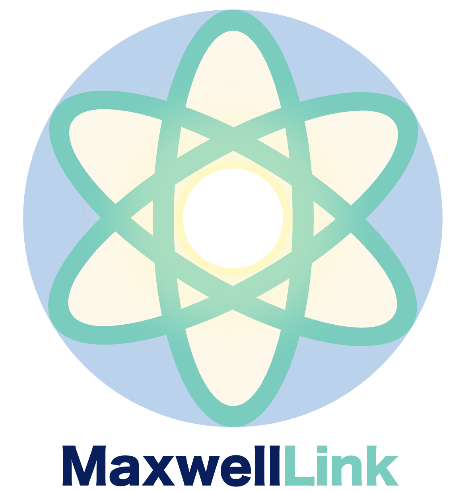

<p align="center">
  
</p>

<p align="center">
  <a href="https://taoeli.github.io/MaxwellLink/overview.html"></a>
  <a href="https://pypi.org/project/maxwelllink/"></a>
  <a href="LICENSE"></a>
  
  <a href="https://arxiv.org/abs/2512.06173"></a>
  <a href="https://doi.org/10.1021/acs.jctc.5c02028"></a>
</p>


**MaxwellLink** is a free and open-source framework for self-consistent light–matter simulations. It connects electromagnetic solvers, such as [MEEP FDTD](https://meep.readthedocs.io/en/latest/) or the built-in normal-mode cavity and laser driven dynamics, to a wide range of molecular drivers, from multilevel open quantum systems to (nonadiabatic) first-principles molecular dynamics.

This code supports both exploratory demonstrations and production-scale calculations. In particular, its socket-based architecture allows large-scale self-consistent light–matter simulations to run efficiently across multiple HPC nodes.

## Key Features

- **Embracing state-of-the-art ecosystems** in both computational electrodynamics and quantum chemistry, extending the boundary of light-matter simulations.
- **Unified Python interfaces** for socket-connected and embedded molecular drivers in light-matter simulations.
- **EM dynamics** from simple to complex systems.
- **Heterogeneous molecular theories** in one simulation.
- **Extensible code structure** to add custom EM solvers or molecular drivers with minimal effort.

## Supported light-matter simulation schemes

The most appealing feature of **MaxwellLink** is that it enables the self-consistent coupling of **one EM solver** plus **N different molecular drivers** concurrently. 


The socket communication technique further allows distributed light-matter simulations on different machines and HPC nodes, i.e., both the EM solver and molecular drivers can have their **own MPI parallel processes**.

As of today, the following [EM solvers](https://maxwelllink.org/em_solvers/index.html) and [molecular drivers](https://maxwelllink.org/drivers/index.html) are supported.

### Supported EM solvers

- Full-feature [MEEP FDTD](https://meep.readthedocs.io/en/latest/) in 1D, 2D, 3D, and cylindrical coordinates (3D simulations at 2D cost),
- Single-mode cavity, 
- Multimode Fabry-Perot cavity, and
- Arbitrary laser driven dynamics. 

### Supported molecular drivers

- Two-level systems and simple harmonic oscillators,
- [QuTiP](https://qutip.org/) model Hamiltonians, 
- In-house RT-TDDFT/Ehrenfest dynamics using [Psi4](https://psicode.org/) integrals, 
- [ASE](https://wiki.fysik.dtu.dk/ase/) classical dynamics, 
- Direct socket connection to modified [LAMMPS](https://github.com/TEL-Research/lammps) for classical MD via `fix mxl`, 
- Lorentz-Bath model for studying energy transfer between polaritons and dark modes,
- Direct socket connection to modified [DFTB+](https://github.com/TEL-Research/dftbplus) for tight-binding BOMD/real-time Ehrenfest dynamics.
- Direct socket connection to modified [CP2K](https://github.com/TEL-Research/cp2k) for real-time TDDFT/Ehrenfest dynamcis in both non-periodic and periodic systems.
- Embedded GPU MD drivers for fast, large-scale simulations.

## Quick Start

Create a fresh conda environment and install using *pip*:

```bash
pip install maxwelllink
```

Optional drivers ([MEEP FDTD](https://meep.readthedocs.io/en/latest/), [QuTiP](https://qutip.org/), [Psi4](https://psicode.org/), [ASE](https://wiki.fysik.dtu.dk/ase/), [LAMMPS](https://www.lammps.org/)) can be added by following the instructions in the [documentation](https://taoeli.github.io/MaxwellLink/overview.html).

## Documentation

Visit the [documentation](https://taoeli.github.io/MaxwellLink/overview.html) for installation details, tutorials, API reference, and guidelines on extending **MaxwellLink**.

## Tutorials

The jupyter notebook tutorials are located at [tutorials/](./tutorials/). Users may also view the tutorials rendered at the [documentation website](https://taoeli.github.io/MaxwellLink/tutorials/index.html).

## Citation

If you find **MaxwellLink** helpful for your research, please cite the following reference:

- X Ji †, AF Bocanegra Vargas †, G Meng, and TE Li. *MaxwellLink: A Unified Framework for Self-Consistent Light-Matter Simulations*. [J. Chem. Theory Comput. 22, 2725–2738](https://doi.org/10.1021/acs.jctc.5c02028) (2026). [[data](https://github.com/TaoELi/maxwelllink_examples)] [[arXiv:2512.06173](https://arxiv.org/abs/2512.06173)] 


## Publications using MaxwellLink

- X Ji, and TE Li. *Nonlinear Freezing of Vibrational Polariton Transport via Mesoscale Simulations*. [Nano Lett. acs.nanolett.6c03367](https://doi.org/10.1021/acs.nanolett.6c03367) (2026). [[data](https://github.com/TaoELi/maxwelllink_examples)]

- G Meng, and TE Li. *Molecular Electrodynamic Relaxation in Dielectric and Plasmonic Cavities*. [arXiv:2610.38992](https://arxiv.org/abs/2610.38992).

- X Ji, and TE Li. *Atomistic Emergence of Vibrational Polariton Condensation* [arXiv:2610.41133](https://arxiv.org/abs/2610.41133).


